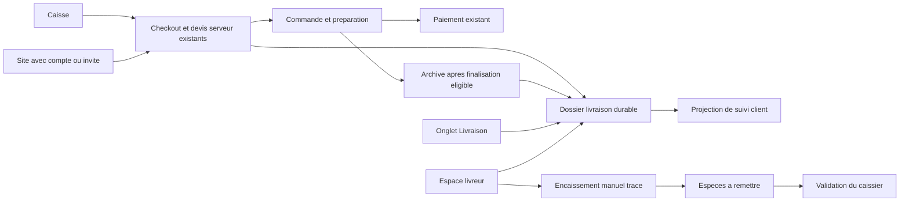

# Gestion des livraisons et des livreurs - V1

Date : 2026-10-16

Statut : perimetre valide en conversation ; specification ecrite soumise a relecture.

Ce document couvre le frontend `pos-app` et le backend voisin `express-pos`.
Il decrit la conception, pas un plan de travaux ni une fonctionnalite deja disponible.
Les choix techniques identifies comme propositions ci-dessous restent soumis a la relecture de ce document.

## 1. Objectif et decisions validees

Un restaurant doit pouvoir recevoir des commandes a livrer depuis la caisse et son site, les attribuer a ses propres livreurs et suivre leur preparation, leur paiement et leur livraison independamment.

| Sujet | Decision V1 validee |
| --- | --- |
| Origine des commandes | Caisse et site de commande existants. |
| Execution | Livreurs du restaurant, avec comptes personnels et espace mobile. |
| Attribution | Manuelle depuis la caisse ; plusieurs commandes possibles par depart. |
| Delai | Des que possible ; aucun creneau reserve. |
| Confirmation de remise | Bouton du livreur, identite et horodatage ; aucun code client de livraison. |
| Probleme | Le livreur signale ; le restaurant decide de la suite. |
| Paiement | A l'avance ou a la livraison ; especes ou TPE independant chez le client. |
| Especes | Encaissement par le livreur, puis remise physique validee par le caissier avec ecarts visibles. |
| Adresses | Plusieurs par client, libellees automatiquement `Adresse 1`, `Adresse 2`, etc., avec une adresse par defaut. |
| Distance | A vol d'oiseau depuis le restaurant ; rayon maximum et paliers de frais. |
| Minimum | Minimum de produits hors frais configurable ; 0 signifie aucun minimum. |
| Gratuite | Seuil facultatif de livraison offerte, desactive par defaut ; rayon maximum toujours applicable. |
| Compte client | Facultatif ; une commande invite reste possible. |
| Connexion client | Code temporaire par e-mail ou WhatsApp, sans mot de passe. |
| Envois de connexion | Centralises par Smart Eat, pas de comptes fournisseurs a configurer par restaurant. |
| Suivi client | Page de suivi, y compris pour les invites. |
| Navigation | Onglet principal `Livraison` : commandes, livreurs, remises d'especes et reglages. |
| Suspension | Par restaurant ; bloque les nouvelles livraisons sans interrompre celles deja acceptees. |

Les codes de connexion e-mail/WhatsApp servent a acceder au compte client. Ils ne constituent ni un code de remise du colis ni une notification de progression de commande.

### Hors perimetre V1

- SMS, y compris pour la connexion ; aucun fournisseur SMS a integrer.
- Notifications de livraison par e-mail, SMS ou WhatsApp. Les seuls envois nouveaux sont les codes de connexion demandes par le client.
- Suivi GPS du livreur, carte temps reel, estimation automatique de l'heure d'arrivee et optimisation de tournee.
- Livraison par un prestataire externe, auto-attribution ou place de marche de livreurs.
- Creneaux, pourboires, remuneration des livreurs et partage d'un meme reglement entre especes et carte.
- Pilotage d'un terminal depuis le telephone du livreur : le TPE de livraison reste independant.
- Refonte generale de la caisse, de la navigation, de l'authentification du personnel ou du click-and-collect.

## 2. Points d'appui observes dans le code

| Existant | Consequence pour la livraison |
| --- | --- |
| `helpers/clients.js` reconstruit les clients depuis les archives, notamment par telephone. | Ce regroupement statistique ne constitue pas un compte client ni une preuve d'identite. Ajouter des donnees clients dediees, sans appropriation automatique de l'historique. |
| `helpers/staffRoles.js` et les autorisations backend distinguent staff et points de service. | Ajouter un role livreur et des permissions dediees, sans reutiliser les acces QR/table ou click-and-collect comme comptes clients. |
| `store/cart.js`, `m_checkout.js` et `m_orderQuote.js` construisent deja un checkout et un devis serveur. | Etendre ce checkout ; ne pas creer une seconde chaine de commandes avec ses propres prix et mouvements de stock. |
| `m_orders.js` archive les details, puis supprime la commande active dans une transaction. | Le dossier de livraison doit survivre a cette suppression et retrouver la representation active ou archivee de la commande. |
| `m_orderTransitions.js` gere la preparation. | Garder cette responsabilite ; la livraison ne remplace pas les statuts cuisine. |
| `m_payments.js` gere Stripe et les remboursements ; `cashRegisterPayment.js` distingue les paiements collectes. | Un livreur ne peut pas ecraser un paiement en ligne ou encore incertain par une declaration manuelle. |
| `m_cashClosures.js` et `cashClosure.js` s'appuient sur les archives et `archived_at`. | Conserver les ventes dans ce reporting, et distinguer leur origine des mouvements physiques d'especes. |
| `src/helpers/mailer.js` utilise deja `node-mailjet`. | Reutiliser le transport Mailjet pour les codes e-mail, avec un contenu et un service d'authentification clients dedies. Sa presence dans le depot ne prouve pas sa configuration operationnelle. |

Ces fichiers sont des points d'integration verifies. Les documents de conception historiques du depot ne prouvent pas, a eux seuls, qu'une autre fonctionnalite est implementee.

## 3. Architecture retenue

Ajouter un dossier `delivery` durable, rattache a la commande existante. Ne pas repousser tout l'archivage jusqu'a la fin de livraison et ne pas dupliquer les commandes dans un second systeme commercial.

Invariants :

- Une commande a au plus un dossier de livraison ; un dossier ne change jamais de commerce.
- Le checkout, le paiement et le stock conservent chacun une source de verite unique.
- `order_source` continue de decrire le canal, par exemple `pos` ou `click_collect`. Un champ distinct `fulfillment_type` decrit `dine_in`, `takeaway` ou `delivery`.
- Le champ historique `customerID` ne devient pas l'identifiant d'un nouveau compte client : il peut deja designer un point de service. Introduire un lien client distinct.
- Preparation, paiement, livraison et detention des especes restent quatre dimensions separees.
- Une livraison payee ou archivee reste dans la liste operationnelle jusqu'a sa resolution.
- Une remise d'especes ne constitue pas une nouvelle vente.

## 4. Parcours et ecrans

### 4.1 Site de commande

Le site conserve son parcours actuel et propose le mode livraison si le restaurant l'autorise. Le client peut continuer en invite ou se connecter par code e-mail/WhatsApp. Les acces personnels clients restent distincts de la session publique du point de service.

Le client renseigne son nom, un telephone joignable, l'adresse de remise et les consignes utiles. Une adresse e-mail n'est pas imposee a un invite ni a un client qui choisit WhatsApp. Un compte connecte peut reutiliser ou ajouter une adresse.

Avant la validation, le serveur controle disponibilite, adresse, rayon et minimum, puis fournit le prix des produits, les remises, les frais et le total a payer. Le choix est paiement en ligne via l'existant ou paiement a la livraison. Les echecs, annulations et reprises de paiement reutilisent le cycle existant, avec le total livraison inclus.

Une commande en ligne non payee n'est jamais presentee comme payee sur la seule base d'un retour navigateur. Une commande en attente de confirmation de paiement ne devient pas attribuable comme une commande acceptee.

### 4.2 Prise de commande en caisse

Le personnel choisit `Livraison` dans le parcours de commande existant. Il recherche ou cree une fiche client propre au restaurant, selectionne une adresse ou en saisit une pour cette commande, puis obtient le meme devis serveur que le site.

La caisse n'a pas de derogation silencieuse au rayon, au minimum ou a la suspension en V1. En cas de blocage, le personnel corrige les donnees ou choisit explicitement un autre mode de retrait.

Le paiement a l'avance ne retire pas une commande de la cuisine tant que sa preparation n'est pas terminee. Une fois l'archivage eligible effectue, le dossier de livraison reste exploitable sans la commande active.

### 4.3 Onglet Livraison du restaurant

- `Commandes` : filtres a attribuer, attribuees/en cours, problemes et terminees ; preparation, paiement et livraison visibles cote a cote.
- `Livreurs` : creation et modification via la gestion staff existante, activation du compte, disponibilite manuelle et nombre de commandes affectees.
- `Remises d'especes` : montants attendus, remises confirmees, solde restant et ecarts par livreur.
- `Reglages` : activation, adresse/position du restaurant, rayon, paliers, minimum, seuil de gratuite et parametrage fiscal des frais.

Les reglages fournisseurs centraux de connexion ne sont pas exposes a chaque restaurant. Les categories, etapes produits et stock ne sont pas reintroduits dans la navigation principale.

### 4.4 Espace mobile livreur

Apres connexion staff habituelle, le livreur arrive directement sur ses missions. Il voit les articles et consignes necessaires a la remise, le telephone, l'adresse, les boutons d'appel et d'itineraire, et le montant restant du. Il peut confirmer la recuperation, enregistrer un paiement manuel, confirmer la livraison et signaler un probleme.

Un livreur peut recuperer plusieurs commandes pretes lors du meme depart. Chaque commande garde son paiement et ses transitions propres ; un ordre manuel de passage ne produit aucune optimisation ni nouvelle commande groupee.

L'ouverture de l'itineraire utilise l'application de navigation externe du telephone. Aucune permission de localisation continue n'est necessaire. Les actions qui modifient un paiement ou un statut exigent une connexion ; aucun succes fictif ni file de paiements hors ligne n'est ajoute.

### 4.5 Suivi client

La page affiche une projection simple : commande recue, preparation, prete, en livraison, livree ou intervention du restaurant. Elle ne montre pas les autres commandes du livreur, les notes internes ni les remises d'especes.

Les invites recoivent le lien prive dans la confirmation affichee a l'ecran, avec une action pour le copier. Pour une commande saisie en caisse, le personnel peut afficher et communiquer ce lien. Aucun envoi automatique de notification n'est ajoute.

Proposition technique : URL `/livraison/suivi#<jeton-opaque>`, avec lecture du jeton par le client Nuxt et requete de suivi dont le jeton est dans le corps. Le fragment n'est pas transmis dans les URLs HTTP ; les logs applicatifs doivent aussi masquer ce secret. Le numero de commande seul ne permet jamais de consulter une livraison.

La reponse de suivi est non cacheable et la page utilise une politique de referent restrictive. La creation du lien est liee au contexte prive de confirmation de commande. En cas de perte du lien, un client proprietaire authentifie, ce contexte prive de checkout ou un operateur autorise peut demander une rotation tracee du jeton. Aucune recherche publique par numero de commande ou telephone ne le restitue. Un rejeu idempotent du checkout ne cree ni seconde livraison ni rotation implicite d'un lien deja communique.

## 5. Etats, attribution et problemes

La preparation reutilise les transitions actuelles ; le paiement reutilise notamment les etats impaye, en attente, paye et rembourse. Aucun nouvel etat de livraison ne remplace ces valeurs.

| Etat livraison | Sens et transition normale |
| --- | --- |
| `unassigned` | Commande acceptee a attribuer par le restaurant. |
| `assigned` | Livreur actif designe ; la preparation peut etre encore en cours. |
| `in_transit` | Livreur ayant confirme la recuperation d'une commande prete. |
| `issue` | Probleme signale avec motif, acteur et etat precedent conserves. |
| `delivered` | Remise au client confirmee, avec acteur et heure serveur. |
| `failed` | Restaurant ayant clos une livraison echouee. |
| `canceled` | Restaurant ayant annule la livraison et engage explicitement le traitement commercial requis. |

Regles proposees pour rendre les transitions executables :

- Seul le restaurant attribue et reattribue. Il ne peut pas attribuer a un compte inactif, indisponible ou d'un autre commerce. Etre deja en mission n'interdit pas plusieurs commandes.
- La recuperation exige une preparation terminee et une affectation au livreur authentifie. Une commande archivee prete fournit le meme controle par son instantane conserve.
- Le livreur ne peut jamais modifier les articles, l'adresse, les frais, une remise ou son affectation.
- Une reattribution avant recuperation est possible. Apres recuperation, elle passe par la resolution d'un probleme avec confirmation du transfert physique par le restaurant.
- Un signalement bloque la conclusion normale jusqu'a resolution du restaurant : reprise, nouvelle tentative, retour, echec ou annulation. Il ne rembourse et ne remet jamais le stock automatiquement.
- La livraison normale exige que le restant du soit nul. Si le restaurant constate une remise deja effectuee sans paiement, lui seul peut consigner une resolution `livree avec impaye` avec motif ; l'impaye reste visible et n'est pas transforme en paiement.
- Les erreurs de saisie d'un etat terminal passent par une correction administrative tracee, pas par un bouton de retour arriere du livreur.
- La suspension des nouvelles livraisons ne bloque aucune mission deja acceptee. Un paiement deja engage peut etre reconcilie apres suspension, sans perdre une commande effectivement payee.
- La desactivation d'un livreur ne supprime ni ses missions ni sa dette d'especes ; le restaurant reprend les affectations et les remises en cours.

Chaque mutation verifie la version courante du dossier et son perimetre. Les operations sensibles ont une cle d'idempotence et un journal append-only. Un conflit renvoie l'etat actuel sans doubler une affectation, un encaissement ou une remise.

## 6. Adresses, distance et tarification

### Adresses et position

Le carnet est rattache a un client du commerce. Une adresse contient numero/voie, code postal, commune, pays, coordonnees validees, complement, batiment/etage/interphone et consignes facultatives. Les donnees d'acces ne sont pas envoyees au geocodeur.

Les libelles sont numerotes a la creation, sans renumerotation des autres adresses apres suppression. Une adresse par defaut au maximum est garantie en transaction. Supprimer ou modifier une adresse du carnet ne change jamais une commande passee.

Choix technique propose : utiliser le service de geocodage de la Geoplateforme IGN pour les adresses en France, via un service backend dedie et remplacable. Il fournit recherche et coordonnees ; le service documente une limite de 50 requetes/seconde/IP. Utiliser cache, debouncing et limitation globale sous cette limite. Aucun appel a l'ancien endpoint BAN n'est introduit. [Documentation IGN](https://ignf.github.io/cartes.gouv.fr-documentation/fr/guides-utilisateur/utiliser-les-services-de-la-geoplateforme/geocodage/)

La couverture France est une hypothese technique proposee pour cette V1. Hors couverture ou en cas d'adresse introuvable/ambigue, la livraison est refusee avec une erreur exploitable. Une coordonnee libre envoyee par le navigateur n'est pas une preuve d'adresse. Le backend valide une selection geocodee et la lie au texte de l'adresse.

La position du restaurant doit elle aussi etre validee avant activation. Pour une adresse deja validee et inchangee, les coordonnees stockees peuvent etre reutilisees meme lors d'une panne du geocodeur. Une nouvelle adresse non resolue ne devient jamais une distance nulle ni une livraison gratuite.

### Distance et frais

Propositions de calcul pour relecture :

1. Calculer la distance Haversine entre les positions validees, en metres, cote serveur. L'arrondi d'affichage en kilometres ne sert pas aux controles.
2. Calculer les produits TTC apres les remises autorisees, hors frais de livraison. Cette base nette sert au minimum et au seuil de gratuite.
3. Refuser une distance superieure au rayon maximum ou une base inferieure au minimum, meme si la gratuite serait atteinte.
4. Choisir le premier palier dont la borne superieure inclut la distance. Les bornes sont strictement croissantes, sans trou depuis 0 jusqu'au rayon maximum ; une distance exactement sur une borne appartient au palier inferieur.
5. Si la gratuite est active et que la base atteint ou depasse son seuil, ramener les frais a 0. Sinon appliquer les frais TTC du palier.
6. Additionner produits nets et frais pour obtenir le total du. Les calculs se font en centimes ; les conversions vers les champs decimaux historiques restent aux frontieres de persistance.

Les paliers, frais, rayon, minimum et seuil sont propres au restaurant. Aucun montant d'exemple discute pendant le cadrage ne devient une valeur de production.

Le serveur publie un devis portant une revision de reglage, les articles, les remises, l'adresse validee, la distance et les frais. Il recalcule ces valeurs lors du checkout et avant d'engager un paiement. Un devis perime ou un total modifie impose une nouvelle confirmation ; aucun montant fourni par le navigateur n'est autoritatif.

Pour chaque revision acceptee de commande, sa distance, son adresse, ses conditions tarifaires et ses montants sont figes. Une modification de reglage n'affecte pas les missions existantes. Une modification explicite avant paiement et avant recuperation recalcule le devis, requiert confirmation et cree une nouvelle revision ; l'ancien instantane reste dans le journal. La charge effective est remplacee en transaction avec cette revision. En V1, une modification d'adresse ou de montant apres paiement est refusee ; le restaurant utilise le parcours explicite d'annulation/remboursement et de nouvelle commande.

### Totaux, TVA et documents

Les frais sont une charge de livraison explicite, jamais un faux produit consommant du stock. Le devis et les lectures de commande exposent `items_total`, `items_discount`, `delivery_fee` et `grand_total`. Le champ historique `subtotal` conserve son sens de total de commande du/encaisse et inclut les frais pour une livraison.

Les details produits seuls ne somment donc plus au total general d'une livraison. Les tickets, PDF, historique, paiements Stripe, remises, remboursements et clotures doivent consommer les memes totaux serveur et une ligne distincte `Livraison`.

Le traitement fiscal des frais est un parametre explicite du restaurant, a renseigner et valider avant activation ; ce document ne prescrit pas un taux legal et n'introduit pas un taux implicite de 0 ou 10 %. Le snapshot des frais conserve TTC, HT, TVA et taux/ventilation configures. Les produits reutilisent les taux emporter deja configures. Les anciennes commandes restent inchangees.

Les remises concernent les produits, pas une seconde remise sur les frais deja calcules. Une remise tardive recalcule minimum, gratuite et total avant paiement ; apres paiement, les instantanes ne sont pas reecrits.

## 7. Paiements, archivage et especes

### Encaissement

- Le paiement en ligne reutilise Stripe existant avec le total incluant les frais. La confirmation autoritative vient du serveur et des webhooks existants.
- Un paiement a la caisse reutilise les moyens autorises existants. Le TPE connecte deja utilise en caisse ne devient pas le TPE du livreur.
- Le livreur peut enregistrer le reglement complet restant du par especes ou carte sur TPE independant. Le montant est derive du serveur. Une declaration carte est identifiee comme manuelle ; elle n'est pas une confirmation Stripe.
- Cette action exige sa mission recuperee et en cours de livraison, avec un paiement encore eligible. En etat de probleme, le restaurant doit d'abord autoriser la reprise ou effectuer lui-meme la resolution financiere.
- Une commande deja payee ne peut pas etre encaissee une seconde fois. Un paiement Stripe en attente ou incertain doit etre reconcilie avant toute substitution manuelle.
- Une declaration du livreur enregistre commerce, mission, utilisateur, montant, moyen, date serveur et cle d'idempotence. Une reponse reseau perdue se reprend par cette cle, sans nouveau reglement.
- Les paiements mixtes et acomptes ne sont pas ajoutes en V1. Un impaye ne peut pas etre efface par une validation de livraison.

Le paiement ne termine pas la preparation. Pour les livraisons uniquement, un archivage ne doit retirer une commande active qu'apres preparation terminee et resolution compatible du paiement. L'archive copie `delivery_id` et les donnees financieres, puis la suppression de la commande active s'effectue dans la meme transaction. Le dossier conserve sa preparation terminee et ses liens de lecture.

Le dossier ne possede pas un solde mutable concurrent de celui du paiement : son etat financier est une projection de la commande active/archivee et des enregistrements de paiement correspondants. Les webhooks et remboursements restent applicables apres archivage via ce lien stable.

### Detention des especes

Un encaissement livreur en especes produit une vente payee et une dette de remise du livreur. Il ne produit pas une entree physique dans le tiroir. Un paiement carte n'alimente jamais cette dette.

Le caissier ouvre le solde du livreur, compte les especes et confirme le montant reel recu. Le montant attendu est recalcule et verrouille cote serveur. La remise enregistre attendu, recu, ecart, caissier et heure, avec les encaissements auxquels elle est affectee.

- Une remise partielle laisse un solde restant du ; un manque n'est pas efface automatiquement.
- Un excedent reste identifie comme excedent a rapprocher ; il ne devient ni du chiffre d'affaires ni un solde negatif attribue silencieusement au livreur.
- Les ecarts sont justifies et regularises par un evenement distinct, sans reecriture de l'encaissement ou de la remise initiale.
- Le livreur consulte son propre solde mais ne valide pas sa propre remise.
- Deux caissiers ou deux requetes ne peuvent pas solder deux fois les memes sommes.

Les rapports de vente comptent la commande une seule fois, selon les conventions d'archivage existantes. Les rapports de caisse distinguent ventes especes en caisse, encaissements externes par livreur et remises physiques effectivement recues. Une remise apres cloture reste dans la periode de sa remise ; elle ne recree pas la vente dans cette nouvelle periode. Ajouter cette ventilation aux instantanes de cloture, sans recalculer les anciennes clotures.

Un probleme ou une annulation logistique ne rembourse rien automatiquement. Le restaurant engage et suit un remboursement financier explicite. Un remboursement complet inclut les frais encaisses ; toute restitution partielle doit designer explicitement les frais concernes, sans inventer un remboursement partiel si le parcours actuel ne le permet pas. Un remboursement en especes precise qui restitue physiquement l'argent et corrige la dette du livreur uniquement si celui-ci l'a restitue, avec autorisation tracee.

## 8. Clients et connexion par code

### Identite et isolation

Les nouveaux comptes clients sont distincts de `users` staff et des comptes/jetons de points de service. Ajouter un sujet d'authentification client dedie. Les codes et sessions sont lies au commerce concerne ; la centralisation du transport ne cree pas un carnet partage entre restaurants.

Une fiche creee par le personnel ne donne pas automatiquement acces au carnet sur Internet. La revendication d'un contact exige sa verification, et une adresse saisie en invite ne peut pas etre recuperee par simple recherche publique de telephone. Les regroupements statistiques de `helpers/clients.js` restent des statistiques, sans migration automatique vers un proprietaire de compte.

Un client peut lier e-mail et telephone WhatsApp au meme compte apres verification de chaque contact dans une session authentifiee. Aucun rapprochement automatique sur le nom ou un telephone non verifie. Un contact deja rattache a un autre compte du commerce produit un conflit explicite, sans fusion silencieuse ni fuite d'adresses.

### Transports proposes

- **E-mail** : Mailjet, deja present dans le backend, avec un service et un modele de code Smart Eat dedies. Utiliser un expediteur central valide ; ne pas reutiliser les anciens liens d'activation staff comme connexion client. [Mailjet Send API](https://dev.mailjet.com/docs/email-api/getting-started/send-first-email)
- **WhatsApp** : integration directe de WhatsApp Business Platform / Cloud API, avec le compte, le numero expediteur et le modele d'authentification Smart Eat. Il s'agit d'un choix technique propose pour eviter un intermediaire SMS non necessaire. Le modele d'authentification doit etre approuve avant utilisation. [Collection officielle Meta](https://www.postman.com/meta/whatsapp-business-platform/request/6vkv46u/create-authentication-template-w-otp-copy-code-button), [conditions des modeles d'authentification documentees par Twilio](https://www.twilio.com/docs/content/whatsappauthentication?display=embedded)

Les comptes et autorisations Meta, l'expediteur Mailjet et les secrets sont des prerequis d'exploitation a fournir, pas des ressources supposees deja creees. Aucune inscription fournisseur, depense ou envoi reel n'est effectue par la redaction de cette specification. Les deux canaux font partie de la V1 cible ; en recette, une absence de configuration est signalee comme telle et ne peut pas etre remplacee par un faux code ou presentee comme une integration terminee.

### Contrat d'authentification propose

- Code aleatoire a 6 chiffres, valable 10 minutes, a usage unique et verifie uniquement par le backend.
- Stocker une empreinte HMAC liee a l'identifiant du challenge, au commerce, au canal et au contact normalise, avec un secret serveur distinct. Aucun code en clair en base ou dans les logs.
- Un renvoi invalide le challenge precedent. Delai minimal de renvoi : 60 secondes ; maximum 5 essais par challenge, 5 envois par contact sur une heure et 20 envois par IP sur une heure. Ces valeurs sont des propositions techniques parametrables globalement.
- Les limites sont persistantes/partagees entre instances et couvrent demandes, renvois et verifications ; elles ne dependent pas seulement de la memoire d'un processus.
- La reponse publique ne revele pas si un compte existe deja. Un echec fournisseur n'ouvre pas de session ; le client peut demander l'autre canal de facon explicite, sans envoi automatique aux deux.
- Proposition de session : jeton opaque revocable, empreinte en base, cookie API `HttpOnly`, `Secure` en HTTPS, `SameSite=Lax`, expiration apres 30 jours au plus. Verification du commerce, de l'origine autorisee et protection CSRF sur les mutations avec cookie.
- Utiliser les domaines Smart Eat autorises et le localhost de developpement ; des vitrines sur des domaines tiers exigeraient une conception de session supplementaire et ne sont pas supposees compatibles par defaut.
- La session client coexiste avec la session staff/service-point sans ecraser son token, son stockage ou son acces.
- Le telephone de contact de livraison et l'identite connectee sont des donnees distinctes. Le compte doit verifier le contact servant a sa connexion, pas necessairement chaque numero de remise saisi.

## 9. Modele de donnees propose

Les noms suivants fixent les responsabilites ; les migrations respecteront les conventions MySQL/dbmate du backend.

| Donnee | Contenu et contraintes principales |
| --- | --- |
| `shop_delivery_settings` | Une ligne par commerce : activation, position validee, rayon en metres, minimum en centimes, gratuite active/seuil, politique fiscale des frais, revision. Desactive par defaut. |
| `shop_delivery_fee_bands` | Bornes de distance et frais TTC du commerce, ordonnes, valides ensemble avec les reglages. |
| `customers` | Fiche client du commerce ; nom et contacts de remise ; ne donne pas seule un droit d'acces public. |
| `customer_identities` | Contacts de connexion verifies et rattachement au client ; unicite commerce/canal/contact normalise. |
| `customer_addresses` | Carnet, numero de libelle, adresse structuree, coordonnees validees et defaut unique par client. |
| `customer_otp_challenges` | Empreinte du code, cible, objet du challenge, expiration, nombre d'essais et statut d'envoi/consommation ; quotas partages associes. |
| `customer_sessions` | Empreinte de session, compte, commerce, expiration et revocation. |
| `deliveries` | Identite durable, commerce, reference de commande d'origine, etat/version, livreur, copie d'adresse/contact/consignes, coordonnees, distance et revision tarifaire, preparation utile apres archivage, empreinte/expiration du jeton de suivi. |
| `delivery_charge_snapshots` | Charge de livraison figee : frais du palier, gratuite appliquee, frais finaux, TTC/HT/TVA et politique fiscale utilisee. Une charge effective par revision acceptee, ancienne revision preservee dans le journal. |
| `delivery_events` | Evenements append-only : acteur, ancienne/nouvelle situation, motif, horodatage serveur, version et idempotence. |
| `delivery_payment_collections` | Trace immutable des declarations manuelles du livreur, liee au paiement commercial autoritatif ; origine especes ou TPE independant. |
| `courier_cash_remittances` | Remise physique : commerce, livreur, caissier, attendu/recu/ecart, date et idempotence. |
| `courier_cash_remittance_allocations` | Affectations des remises aux encaissements ; empechent le double rapprochement et permettent un solde restant. |

Etendre `users` pour la disponibilite manuelle du livreur et ajouter `COURIER = 6` aux roles, sans renumeroter les acces existants. L'autorisation du role 6 doit etre mise a jour dans les validations staff, les sessions et les listes d'acces backend autant que dans les libelles frontend.

Ajouter a `orders` et `archives` des liens nullables `delivery_id` et `customer_account_id` ainsi que `fulfillment_type`. Les lignes historiques n'ont aucune livraison ; leur interpretation sur place/emporter est conservee. Les liens vers une livraison sont uniques dans chacune des deux representations. L'archivage verrouille le dossier et copie le lien dans la meme transaction pour qu'une seule representation commerciale soit resolue apres commit.

Ne pas imposer une cle etrangere du dossier vers une commande active qui serait supprimee a l'archivage. Le dossier et les instantanes ne sont pas supprimes en cascade avec un article, une adresse ou un compte livreur.

Les identifiants du commerce sont verifies sur les relations, pas seulement sur la requete d'entree. Les modifications d'adresse de commande, d'affectation, de paiement et de solde passent par les services responsables et leurs transactions partagees.

## 10. Droits et contrats API

| Acteur | Autorisations |
| --- | --- |
| Administrateur du commerce | Reglages, comptes livreurs, attribution, resolution, remises et corrections tracees. |
| Caissier avec permission `delivery` | Commandes livraison, attribution, resolution courante et validation des remises ; pas de configuration fournisseur ni de gestion des roles. |
| Livreur | Ses seules missions et son solde ; recuperation, signalement, declaration de paiement et confirmation de remise au client. |
| Client connecte | Son compte, ses adresses et ses commandes dans le commerce autorise. |
| Invite | Creer une commande via le parcours public autorise et lire sa seule projection de suivi via jeton prive. |

Ajouter une permission de module `delivery`. Elle ouvre les parcours operateurs autorises mais ne donne pas au livreur les droits du caissier : les actions et le proprietaire de chaque mission sont controles cote serveur. Les reglages et comptes restent reserves a l'administration selon les conventions staff existantes.

Les chemins ci-dessous sont relatifs au prefixe API existant. Ils decrivent des contrats nouveaux proposes, pas des routes deja disponibles.

| Groupe | Contrats |
| --- | --- |
| Devis et commande | `POST /delivery/quotes`, puis extension du checkout existant avec mode, adresse validee/devis et lien client verifie. |
| Clients | `POST /customer-auth/challenges`, `POST /customer-auth/verify`, `GET /customer-auth/session`, `POST /customer-auth/logout`, liaison verifiee d'un second contact ; lectures et mutations `/customer/addresses`. |
| Fiches en caisse | Recherche/creation de clients et adresses propres au commerce par endpoints staff dedies ; aucune recherche publique par telephone. |
| Reglages | Lecture/ecriture `/delivery/settings` avec revision attendue, controle admin et validations atomiques des paliers. |
| Dispatch | `GET /deliveries`, `GET /deliveries/:id`, actions `/assign` et `/resolve-issue` avec version et idempotence. |
| Livreurs | Creation/modification via les endpoints staff existants ; `/delivery/couriers` pour disponibilites et projections operationnelles. |
| Mobile | `GET /courier/deliveries`, actions `/courier/deliveries/:id/pickup`, `/collect-payment`, `/deliver` et `/report-issue`. |
| Especes | Lecture du solde, `POST /delivery/cash-remittances`, lecture des remises et regularisations administratives tracees. |
| Suivi invite | `POST /delivery/tracking/read` avec jeton opaque dans le corps ; projection publique limitee. |

Les montants, coordonnees, identifiants de client/livreur et etats recus sont valides ou derives cote serveur. Les commandes de livraison participent aux cles d'idempotence existantes : l'empreinte de checkout inclut le mode, l'adresse, la revision tarifaire et le choix de paiement. Une meme cle avec un contenu different renvoie un conflit.

Proposition pour le suivi : rafraichissement toutes les 15 secondes lorsque la page est visible, reprise au retour au premier plan, arret a l'expiration de session/jeton et espacement apres erreur. Aucune infrastructure WebSocket n'est imposee a cette V1.

## 11. Erreurs, donnees personnelles et continuite

| Situation | Comportement attendu |
| --- | --- |
| Livraison suspendue ou reglages incomplets | Aucune nouvelle livraison acceptee ; les commandes existantes continuent. |
| Adresse ambigue, hors rayon ou minimum non atteint | Explication precise avant paiement ; panier conserve, aucun choix force vers l'emporter. |
| Geocodeur indisponible | Reutiliser uniquement une adresse deja validee et inchangee ; sinon proposer de reessayer. |
| Frais modifies entre devis et checkout | Retourner le devis actuel et demander confirmation avant paiement. |
| Connexion e-mail/WhatsApp indisponible | Afficher le canal indisponible, proposer l'autre ou la commande invite ; aucune session fictive. |
| Reponse perdue apres paiement ou remise | Relire le resultat idempotent ; ne pas redemander de paiement et ne pas doubler la remise. |
| Archivage pendant consultation livreur | Le meme dossier reste lisible avec les donnees archivees. |
| Affectation changee pendant une action | Refus de conflit ; rechargement sans exposer les nouvelles missions d'un autre livreur. |
| Commande payee puis annulee | Resolution logistique et traitement financier explicites, chacun avec son propre etat. |
| Echec de livraison | Aucune liberation de stock, annulation, nouvelle commande ou restitution d'argent automatique. |

L'acces aux coordonnees et consignes est limite au besoin operationnel. Une fois la mission terminee, le livreur conserve son recapitulatif et ses sommes a remettre, sans carnet client ni acces permanent a l'interphone. Le restaurant garde l'historique utile a la resolution et aux documents de vente.

Proposition de suivi prive : jeton aleatoire de 256 bits au minimum, empreinte en base, revocable, expiration 30 jours apres creation ou 7 jours apres fermeture, selon la premiere echeance. Un jeton expire n'empeche pas le traitement interne ni la consultation authentifiee autorisee.

Pas de journalisation des codes, secrets fournisseurs, jetons de suivi ni des corps contenant les consignes d'acces. Toute lecture publique applique une projection explicite de champs. Les delais de conservation des donnees personnelles restent ceux de la politique du service ; ce document n'invente pas une duree legale de conservation ni une suppression des pieces de vente.

## 12. Decoupage et integration frontend/backend

Le plan d'implementation devra organiser ces lots dependants, sans presenter un lot partiel comme la V1 complete :

1. **Fondations livraison** : schema, devis, tarifs, instantanes, liaison active/archivee et preparation/paiement independants.
2. **Clients et adresses** : fiches, carnet, sessions dediees et codes e-mail/WhatsApp centraux.
3. **Caisse et site** : choix de livraison, checkout autoritatif, paiement avant depart ou a reception et suivi prive.
4. **Dispatch et mobile** : role livreur, affectations multiples, recuperations, confirmations et resolution des problemes.
5. **Especes et documents** : declarations manuelles, remises, ecarts, tickets, remboursements et clotures coherents.
6. **Recette complete** : migrations, non-regressions, permissions, fournisseurs reels et parcours sur telephone.

Sur le frontend, reutiliser Nuxt 2, Vuetify, Vuex et les helpers existants ; ajouter des modules limites pour la livraison et l'identite client, sans refondre les stores historiques. Le suivi invite est une route explicitement publique a jeton, pas une ouverture des routes commandes staff.

Sur le backend, conserver les couches routers/controllers/modules existantes : routes et controles minces, services metier pour devis/livraison/encaissement, repositories SQL transactionnels et helpers purs pour distance et tarification. Les evenements financiers et l'archivage doivent partager les transactions necessaires, pas etre une suite d'appels HTTP independants.

Les transports Mailjet, WhatsApp et geocodage sont des frontieres separees de la logique metier, testables sans envoi payant. Reutiliser Mailjet et les clients HTTP deja disponibles avant d'ajouter une dependance. Aucun moteur de cartographie, routage ou SDK SMS n'est necessaire pour le calcul choisi.

## 13. Validation et criteres d'acceptation

### Tests backend significatifs

- Bornes de rayon/paliers, distance non arrondie, adresses invalides, coordonnees falsifiees, minimum et gratuite exactement aux seuils.
- Produits remises + frais = total du = montant de paiement ; coherent dans ticket, archive, remboursement et ventilation TVA.
- Replay de checkout avec meme cle, rejet d'un payload modifie, confirmation d'un devis change et suspension pendant paiement engage.
- Stock mouvemente une fois ; pas de decrement pour les frais ; pas de retour stock implicite sur probleme de livraison.
- Commande payee avant preparation encore visible en cuisine ; commande archivee toujours visible dans le dispatch et l'espace livreur.
- Deux affectations concurrentes, recuperation prematuree, livreur d'un autre commerce, compte desactive et transfert apres recuperation.
- Encaissement manuel concurrent avec paiement Stripe, reprise apres perte reseau, remboursement apres archivage et absence de double encaissement.
- Remises partielles, manquants, excedents, deux caissiers concurrents, reglement d'un ecart, remise apres cloture sans deuxieme vente.
- OTP expire, reutilise, renvoye, mauvaises tentatives, quotas partages, panne transport, liaison d'identites et rejet des fusions non verifiees.
- Isolation commerce/client/staff/service-point, sessions revoquees, jeton invite invalide/expire et projection sans donnees internes.
- Migration de donnees existantes sans conversion d'un point de service en client ou d'une archive historique en livraison.

### Tests frontend et recette

- Commande invite et connectee, chacun depuis la caisse/site approprie, avec adresses enregistrees et nouvelles.
- Codes de connexion e-mail et WhatsApp reellement recus et verifies avec les comptes centraux de recette ; aucun test de production envoye a un tiers non autorise.
- Affichage du devis avant paiement, changement de tarif, minimum, gratuite et erreurs conservant le panier.
- Un livreur recuperant plusieurs commandes et confirmant chacune, dont une deja payee et une a encaisser par especes ou TPE independant.
- Signalement d'un client absent, resolution uniquement au restaurant et absence de remboursement automatique.
- Comparaison du solde livreur et des especes physiques avant/apres remise, y compris autour d'une cloture.
- Consultation de la meme livraison avant/apres archivage ; reimpression conservant l'adresse et les frais d'origine.
- Verifications desktop/mobile : actions tactiles, libelles lisibles, absence de chevauchement, chargement, erreur et reseau coupe.
- Non-regression sur place, emporter, QR table, borne, click-and-collect existant, Stripe, permissions et navigation POS.

### Mise en service

Les migrations additives sont appliquees au backend avant d'activer les interfaces. Les champs historiques ont des valeurs compatibles et les livraisons restent desactivees par defaut pour tous les commerces.

Les secrets et identifiants Mailjet/WhatsApp restent exclusivement dans l'environnement backend, selon la gestion chiffree existante du backend. Ils ne sont jamais ajoutes aux variables publiques Nuxt ni a la configuration navigateur. Le geocodeur et les limites globales sont configures cote serveur.

La V1 est recettee en staging avec les deux canaux de connexion, les deux origines de commandes, l'archivage en cours de livraison, les encaissements et les remises. L'activation d'un restaurant exige position, rayon, paliers et traitement fiscal configures. Aucun exemple de frais n'est publie automatiquement.

Un retour arriere commence par suspendre les nouvelles livraisons tout en conservant une version capable de terminer les missions, paiements et remises existants. Ne pas supprimer les nouvelles tables ni revenir a une version qui ignore les frais d'une commande deja engagee.

## 14. Points proposes a relire explicitement

Le perimetre fonctionnel de la section 1 est valide. Les decisions suivantes concretisent ce perimetre et sont proposees a la validation de cette specification :

- Mailjet existant pour l'e-mail ; WhatsApp Cloud API direct pour les codes, avec prerequis centraux d'exploitation.
- Geocodage IGN et couverture France ; aucune estimation de distance de secours pour une adresse non resolue.
- Base des minimum/gratuite = produits apres remises, hors frais ; bornes inclusives et absence de derogation caisse en V1.
- Traitement fiscal des frais explicite avant activation, sans taux legal deduit par le logiciel.
- Restrictions de modification apres paiement, controle du restant du avant livraison normale et resolution exceptionnelle par le restaurant.
- Comptes clients et carnets isoles par commerce ; liaison e-mail/WhatsApp seulement apres verification des contacts.
- Parametres initiaux de securite, session client separee et duree du lien de suivi prive.

L'approbation de la synthese en conversation a autorise la redaction de ce document. Sa relecture et sa validation precedent le plan d'implementation ; ni le code applicatif, ni les migrations, ni les deploiements de livraison ne sont inclus dans cette etape.
